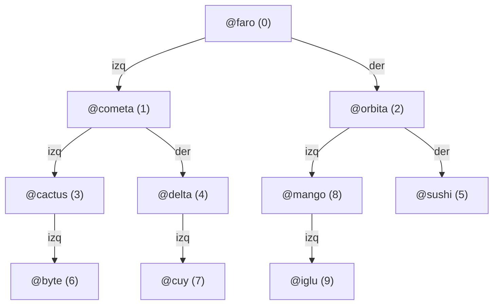

# Nido · Informe técnico — Capítulos 1 y 2 (borrador E2 · v0.5)

**Grupo B · comunidad `nido-colibri` · NRC 42964**

> Borrador en Markdown para pasar a la plantilla `EDD-S15-EvalU4-Plantilla-Informe-NRC42964.docx`. Los diagramas del 2.1 se pueden pasar a limpio a mano o pegar el render de Mermaid.

---

## Capítulo 1 · Análisis del problema

### 1.1 Descripción del problema

Nido es una red social de consola para la comunidad `nido-colibri` del grupo de software libre de la universidad. La usan los miembros del campus, que se registran con un `@usuario`, siguen a otras cuentas y publican posts. El sistema debe guardar las cuentas de forma que se encuentren rápido y se listen en orden alfabético, registrar quién sigue a quién sabiendo que seguir no es recíproco, calcular hasta dónde llega un post si cada seguidor lo comparte con los suyos, y guardar y recuperar la comunidad completa desde un archivo sin perder la forma del árbol ni los ids. Todo se construye desde cero en C++ con `struct`, punteros, `new` y `delete`, sin contenedores de la biblioteca estándar. La comunidad parte con 10 cuentas y 16 seguimientos, y admite como máximo 12 cuentas.

### 1.2 Variables y condiciones

| Variable | Tipo en C++ | Qué representa | Valor inicial o rango | Condición o regla que la afecta |
|---|---|---|---|---|
| `MAX` | `const int` | Máximo de cuentas de la comunidad | 12 | Regla 1: no se registra la cuenta 13 |
| `COMUNIDAD` | `const string` | Nombre de la instancia | `"nido-colibri"` | Se muestra en el aviso `nido@nido-colibri:~$` |
| `usuario` | `string` (en `NodoUsuario`) | Nombre de la cuenta | `@` + 1 a 15 caracteres `a-z`, `0-9` | Regla 1: válido y no repetido |
| `id` | `int` (en `NodoUsuario`) | Orden de registro; fila y columna en `sigue` | 0 a `nUsuarios − 1` | Regla 2: no cambia nunca |
| `NodoUsuario` | `struct` | Nodo del ABB: `usuario`, `id`, `izq`, `der` | Hijos en `nullptr` al crearse | Regla 3: menores a la izquierda, mayores a la derecha |
| `raiz` | `NodoUsuario*` | Primer nodo del ABB | `nullptr` (árbol vacío) | Su forma depende del orden de registro |
| `nUsuarios` | `int` | Cuentas registradas (ids usados) | 0 a 12; inicia en 10 con la ficha | Crece en 1 con cada registro |
| `porId` | `NodoUsuario*[MAX]` | Pasa de un id al nodo de su cuenta | Se llena al registrar | `porId[id]` válido solo si `id < nUsuarios` |
| `sigue` | `int[MAX][MAX]` | Matriz de adyacencia del grafo dirigido | Todo en 0; 16 casillas en 1 con la ficha | `sigue[a][b] == 1`: a sigue a b. Regla 5: sin diagonal ni repetidos |
| seguidores de u | `int` (calculado) | Grado de entrada: suma de la columna de u | 0 a `nUsuarios − 1` | `perfil`, `popular` (regla 7) |
| siguiendo de u | `int` (calculado) | Grado de salida: suma de la fila de u | 0 a `nUsuarios − 1` | `perfil` |
| `visto` | `bool[MAX]` | Cuentas ya visitadas por el DFS | Todo en `false` | Regla 8: evita ciclos; la propia @u no se cuenta |
| alcanzados | `int` | Cuentas a las que llega un post | 0 a `nUsuarios − 1` | `visto` en true menos 1 |
| `ARCHIVO` | `const string` | Archivo de persistencia | `"nido.txt"` | Regla 9: líneas `U usuario id` en preorden y `S a b` |
| `m` | `int` | Seguimientos guardados o cargados | 0 | Se suma 1 por cada línea `S` |
| `N_U`, `N_S` | `const int` | Cuentas y seguimientos de la ficha | 10 y 16 | Se cargan al iniciar el programa |

### 1.3 Requerimientos funcionales y no funcionales

| ID | Requerimiento funcional | Orden(es) | Estructura |
|---|---|---|---|
| RF1 | Registrar una cuenta válida con el siguiente id | `registrar` / `signup` | ABB · insertar |
| RF2 | Mostrar id, seguidores y seguidos de una cuenta | `perfil` / `whois` | ABB · buscar + matriz · grados |
| RF3 | Listar las cuentas en orden alfabético | `usuarios` / `users` | ABB · enorden |
| RF4 | Mostrar el preorden, los nodos, la altura y las hojas | `arbol` / `tree` | ABB · preorden, contar, altura, hojas |
| RF5 | Seguir y dejar de seguir a una cuenta | `seguir`, `dejar` | Matriz · cambiar una casilla |
| RF6 | Listar seguidores y seguidos en orden de id | `seguidores`, `siguiendo` | Matriz · columna y fila |
| RF7 | Listar mutuos y la cuenta más popular (empate: menor id) | `mutuos`, `popular` | Matriz · fila + columna, grados |
| RF8 | Calcular el alcance de un post y si llega a una cuenta | `alcance`, `llega` | Matriz · DFS recursivo |
| RF9 | Guardar y cargar la comunidad con los mismos ids y el mismo árbol | `guardar`, `cargar` | Archivo + ABB (preorden) + matriz |
| RF10 | Resumen de la comunidad y salida liberando la memoria | `reporte`, `salir` | ABB + matriz · liberar en postorden |

| ID | Requerimiento no funcional (cómo debe comportarse) |
|---|---|
| RNF1 | Ninguna entrada inválida cierra el programa (orden inexistente, cuenta sin `@`, con mayúsculas, inexistente, seguirse a sí misma). |
| RNF2 | Compila en Dev-C++ con C++11 sin errores; solo usa `string`, `iostream`, `sstream` y `fstream` (sin `vector`, `map`, `set`, `list`, `queue` ni `stack`). |
| RNF3 | Las funciones del árbol y `difundir` son recursivas, cada una con su caso base. |
| RNF4 | Los textos que imprime no llevan tildes ni ñ. |
| RNF5 | Acepta cada orden en español o en inglés y repite la orden leída con `>` para que la salida redirigida a un archivo se lea completa. |
| RNF6 | Al salir libera con `delete` todos los nodos y muestra `Nodos liberados: N`. |

### 1.4 Estructuras propuestas y justificación

**¿Por qué un ABB y no una lista enlazada?** En una lista, buscar una cuenta obliga a revisar los nodos uno por uno (hasta 10 comparaciones con la ficha). En el ABB cada comparación descarta un subárbol entero: con nuestra ficha la altura es 4, así que cualquier búsqueda cuesta como máximo 4 comparaciones. Además, el recorrido en enorden entrega las cuentas en orden alfabético sin tener que ordenarlas.

**¿Por qué una matriz y por qué no es simétrica?** Con como máximo 12 cuentas, una matriz de 12 × 12 ocupa poco y permite saber si a sigue a b en un solo paso (`sigue[a][b]`). Los seguidores de una cuenta son su columna y sus seguidos son su fila. No es simétrica porque seguir es una relación dirigida: `@faro` sigue a `@delta` (`sigue[0][4] = 1`), pero `@delta` no sigue a `@faro` (`sigue[4][0] = 0`). Solo cuando las dos casillas están en 1 la relación es mutua, como `@cometa` y `@delta`.

**¿Por qué recursión?** El ABB es una estructura recursiva: cada hijo es la raíz de otro árbol. Buscar, insertar, recorrer, contar, medir la altura, contar hojas, guardar en preorden y liberar en postorden se escriben como "resolver el nodo y repetir con cada subárbol", con el árbol vacío como caso base. En el alcance pasa lo mismo con el grafo: un post llega a los seguidores de @u, y desde cada uno vuelve a llegar a sus seguidores. El DFS recursivo baja por cada cadena de seguidores y, cuando se agota, la recursión regresa sola al punto anterior; el arreglo `visto` evita repetir cuentas y quedar atrapado en ciclos como `@cometa → @sushi → @cometa`.

---

## Capítulo 2 · Diseño de la solución

### 2.1 El árbol y la matriz de su comunidad

**Orden de registro (id):** `@faro` 0 · `@cometa` 1 · `@orbita` 2 · `@cactus` 3 · `@delta` 4 · `@sushi` 5 · `@byte` 6 · `@cuy` 7 · `@mango` 8 · `@iglu` 9

**Inserción paso a paso**

| # | Cuenta (id) | Camino de comparaciones | Queda como |
|---|---|---|---|
| 1 | `@faro` (0) | árbol vacío | raíz |
| 2 | `@cometa` (1) | < faro | hijo izquierdo de @faro |
| 3 | `@orbita` (2) | > faro | hijo derecho de @faro |
| 4 | `@cactus` (3) | < faro, < cometa | hijo izquierdo de @cometa |
| 5 | `@delta` (4) | < faro, > cometa | hijo derecho de @cometa |
| 6 | `@sushi` (5) | > faro, > orbita | hijo derecho de @orbita |
| 7 | `@byte` (6) | < faro, < cometa, < cactus | hijo izquierdo de @cactus |
| 8 | `@cuy` (7) | < faro, > cometa, < delta | hijo izquierdo de @delta |
| 9 | `@mango` (8) | > faro, < orbita | hijo izquierdo de @orbita |
| 10 | `@iglu` (9) | > faro, < orbita, < mango | hijo izquierdo de @mango |

**Árbol resultante (ASCII)**

```
                    @faro (0)
                 /             \
        @cometa (1)            @orbita (2)
         /       \              /        \
  @cactus (3)  @delta (4)  @mango (8)   @sushi (5)
     /            /           /
 @byte (6)    @cuy (7)    @iglu (9)
```

**Árbol resultante (Mermaid)**



Nodos: 10 · altura: 4 (camino más largo `@faro → @cometa → @cactus → @byte`, igual de largo que `@faro → @cometa → @delta → @cuy` y `@faro → @orbita → @mango → @iglu`) · hojas: 4 (`@byte`, `@cuy`, `@iglu`, `@sushi`).

**Matriz `sigue` de 10 × 10** (fila = quien sigue; columna = a quién sigue)

| a \ b | 0 faro | 1 cometa | 2 orbita | 3 cactus | 4 delta | 5 sushi | 6 byte | 7 cuy | 8 mango | 9 iglu | **siguiendo** |
|---|---|---|---|---|---|---|---|---|---|---|---|
| **0 faro** | 0 | 1 | 0 | 0 | 1 | 0 | 0 | 0 | 0 | 0 | 2 |
| **1 cometa** | 0 | 0 | 0 | 1 | 1 | 1 | 0 | 0 | 0 | 0 | 3 |
| **2 orbita** | 0 | 0 | 0 | 0 | 0 | 0 | 0 | 0 | 0 | 0 | 0 |
| **3 cactus** | 1 | 0 | 0 | 0 | 0 | 0 | 0 | 0 | 0 | 0 | 1 |
| **4 delta** | 0 | 1 | 0 | 0 | 0 | 0 | 1 | 0 | 0 | 0 | 2 |
| **5 sushi** | 0 | 1 | 0 | 0 | 0 | 0 | 0 | 0 | 0 | 1 | 2 |
| **6 byte** | 1 | 0 | 0 | 0 | 0 | 0 | 0 | 0 | 0 | 0 | 1 |
| **7 cuy** | 0 | 1 | 0 | 0 | 0 | 1 | 0 | 0 | 0 | 1 | 3 |
| **8 mango** | 0 | 1 | 0 | 0 | 0 | 1 | 0 | 0 | 0 | 0 | 2 |
| **9 iglu** | 0 | 0 | 0 | 0 | 0 | 0 | 0 | 0 | 0 | 0 | 0 |
| **seguidores** | 2 | 5 | 0 | 1 | 2 | 3 | 1 | 0 | 0 | 2 | **16** |

La matriz no es simétrica. Solo hay **2 pares mutuos** (ambas casillas en 1): **@cometa–@delta** (`sigue[1][4]` y `sigue[4][1]`) y **@cometa–@sushi** (`sigue[1][5]` y `sigue[5][1]`). Por ejemplo, `@cometa` sigue a `@cactus` (`sigue[1][3] = 1`), pero `@cactus` no sigue a `@cometa` (`sigue[3][1] = 0`). `@orbita`, `@cuy` y `@mango` tienen la columna en ceros: nadie los sigue.

### 2.2 Operaciones y estructuras

| Orden | Estructura | Operación | Qué recorre o qué cambia |
|---|---|---|---|
| registrar | ABB | insertar (recursivo) | Baja por un camino hasta un `nullptr` y cuelga el nodo; llena `porId[nUsuarios]` y suma 1 a `nUsuarios` |
| perfil | ABB + matriz | buscar + fila y columna | Un camino del ABB; suma la fila (siguiendo) y la columna (seguidores) de su id |
| usuarios | ABB | enorden | Todos los nodos: izquierda, nodo, derecha |
| arbol | ABB | preorden, contar, altura, hojas | Todos los nodos, cuatro recorridos recursivos |
| seguir / dejar | Matriz | cambiar una casilla | `sigue[a][b]` pasa de 0 a 1 (seguir) o de 1 a 0 (dejar) |
| seguidores | Matriz | recorrer una columna | Columna del id, de 0 a `nUsuarios − 1` |
| siguiendo | Matriz | recorrer una fila | Fila del id, de 0 a `nUsuarios − 1` |
| mutuos | Matriz | fila y columna | Marca x si `sigue[u][x]` y `sigue[x][u]` están en 1 |
| popular | Matriz | grado de entrada de cada cuenta | Todas las columnas; se queda con el máximo (empate: menor id) |
| alcance / llega | Matriz | DFS recursivo | Columnas de las cuentas visitadas, con el arreglo `visto` |
| guardar / cargar | Archivo + ABB + matriz | preorden + recorrido por filas | Escribe/lee líneas `U` (preorden) y `S` (por filas); cargar libera y reconstruye |
| reporte | ABB + matriz | contar casillas, altura, hojas | Toda la matriz y todo el árbol |
| salir | ABB | liberar (postorden) | Todos los nodos: hijos primero, después el nodo |

### 2.3 Pseudocódigo

```
ALGORITMO insertar(r, nuevo)            // r se pasa por referencia
  SI r = nulo ENTONCES
     r ← nuevo
     DEVOLVER verdadero                 // caso base: hueco encontrado
  FIN SI
  SI nuevo.usuario = r.usuario ENTONCES
     DEVOLVER falso                     // caso base: cuenta repetida
  FIN SI
  SI nuevo.usuario < r.usuario ENTONCES
     DEVOLVER insertar(r.izq, nuevo)    // caso recursivo: baja a la izquierda
  SINO
     DEVOLVER insertar(r.der, nuevo)    // caso recursivo: baja a la derecha
  FIN SI
FIN
```

```
ALGORITMO difundir(v, visto, imprimir)
  visto[v] ← verdadero
  PARA x DESDE 0 HASTA nUsuarios - 1
     SI sigue[x][v] = 1 Y NO visto[x] ENTONCES     // x sigue a v (columna de v)
        SI imprimir ENTONCES ESCRIBIR porId[x].usuario
        difundir(x, visto, imprimir)              // caso recursivo
     FIN SI
  FIN PARA
  // caso base implícito: ningún seguidor sin visitar, la recursión regresa
FIN
```

```
ALGORITMO cargar()
  ABRIR f ← "nido.txt"
  SI no existe ENTONCES ESCRIBIR "E: No existe nido.txt"; TERMINAR
  liberar(raiz); raiz ← nulo; nUsuarios ← 0
  PARA i DESDE 0 HASTA MAX - 1: porId[i] ← nulo
  PARA i, j DESDE 0 HASTA MAX - 1: sigue[i][j] ← 0
  m ← 0
  MIENTRAS LEER tipo DE f
     SI tipo = "U" ENTONCES
        LEER usuario, id
        nodo ← crearUsuario(usuario, id)
        insertar(raiz, nodo)               // en preorden: el árbol queda idéntico
        porId[id] ← nodo
        SI id + 1 > nUsuarios ENTONCES nUsuarios ← id + 1
     SINO SI tipo = "S" ENTONCES
        LEER ua, ub
        a ← buscar(raiz, ua); b ← buscar(raiz, ub)
        sigue[a.id][b.id] ← 1
        m ← m + 1
     FIN SI
  FIN MIENTRAS
  ESCRIBIR "Cargado: ", contar(raiz), " cuentas y ", m, " seguimientos | altura ", altura(raiz)
FIN
```

### 2.4 Traza a mano de la secuencia oficial

| # | Orden | Resultado de la traza a mano |
|---|---|---|
| 1 | `arbol` | `Preorden: @faro @cometa @cactus @byte @delta @cuy @orbita @mango @iglu @sushi` · `Nodos: 10 \| altura: 4 \| hojas: 4` |
| 2 | `usuarios` | `Usuarios (enorden): @byte @cactus @cometa @cuy @delta @faro @iglu @mango @orbita @sushi` |
| 3 | `perfil @delta` | `@delta \| id 4 \| seguidores 2 \| siguiendo 2` (columna 4: faro, cometa; fila 4: cometa, byte) |
| 4 | `seguidores @delta` | `Seguidores de @delta (2): @faro @cometa` ✔ punto de control (columna 4 en orden de id: 0 y 1) |
| 5 | `siguiendo @delta` | `@delta sigue a (2): @cometa @byte` (fila 4: ids 1 y 6) |
| 6 | `mutuos @delta` | `Mutuos de @delta (1): @cometa` (fila 4 ∩ columna 4: solo id 1; @byte no sigue a @delta y @faro no es seguido por @delta) |
| 7 | `popular` | `Popular: @cometa \| seguidores: 5` (columna 1: faro, delta, sushi, cuy, mango; el siguiente es @sushi con 3) |
| 8 | `alcance @sushi` | `Alcance de @sushi: @cometa @faro @cactus @byte @delta @cuy @mango \| alcanzados: 7` |
| 9 | `llega @sushi @byte` | `Un post de @sushi llega a @byte: si` (@byte es la 4.ª cuenta visitada en el DFS de la orden 8) |
| 10 | `llega @delta @iglu` | `Un post de @delta llega a @iglu: no` (@iglu no sigue a nadie: su fila está en ceros, así que ningún DFS la visita) |

**Orden de visita del DFS en la orden 8** (`alcance @sushi`, se recorre la columna de cada cuenta de id 0 a 9):

1. **@cometa** — en la columna 5 (@sushi), el primer id con 1 es 1 → visita @cometa y baja.
2. **@faro** — en la columna 1 (@cometa), el primer id no visto con 1 es 0 → visita @faro y baja.
3. **@cactus** — en la columna 0 (@faro), id 3 → visita @cactus. Su columna 3 solo tiene a @cometa (visto) → regresa a @faro.
4. **@byte** — sigue la columna 0: id 6 → visita @byte y baja.
5. **@delta** — en la columna 6 (@byte), id 4 → visita @delta. Su columna 4 tiene a @faro y @cometa (vistos) → regresa a @byte, luego a @faro (columna 0 agotada) y luego a @cometa.
6. **@cuy** — sigue la columna 1 de @cometa: id 4 visto, id 5 es @sushi (origen, visto), id 7 → visita @cuy. Su columna 7 está en ceros → regresa.
7. **@mango** — sigue la columna 1: id 8 → visita @mango. Su columna 8 está en ceros → regresa. Columna 1 agotada → regresa a @sushi, cuyos demás seguidores (7 y 8) ya están vistos. Fin.

Orden de visita: `1 @cometa · 2 @faro · 3 @cactus · 4 @byte · 5 @delta · 6 @cuy · 7 @mango`. No llegan `@orbita` ni `@iglu`, porque no siguen a nadie.

```
@sushi (origen)
 └─ 1 @cometa
     ├─ 2 @faro
     │   ├─ 3 @cactus   (su seguidor @cometa ya visto)
     │   └─ 4 @byte
     │       └─ 5 @delta (sus seguidores @faro y @cometa ya vistos)
     ├─ 6 @cuy          (nadie lo sigue)
     └─ 7 @mango        (nadie lo sigue)
```

**DFS de la orden 10** (`llega @delta @iglu`): desde @delta se visitan @faro, @cactus, @cometa, @sushi, @cuy, @mango y @byte. `visto[9]` queda en `false` → **no**.

**Comprobación con el programa (v0.5):** las órdenes 1 a 5 ya se ejecutaron con el programa y coinciden con esta traza. Las órdenes 6 a 10 dependen de R4 y R5 (Etapa 3); se compararán con `pruebas/salida.txt` en la v1.0.
