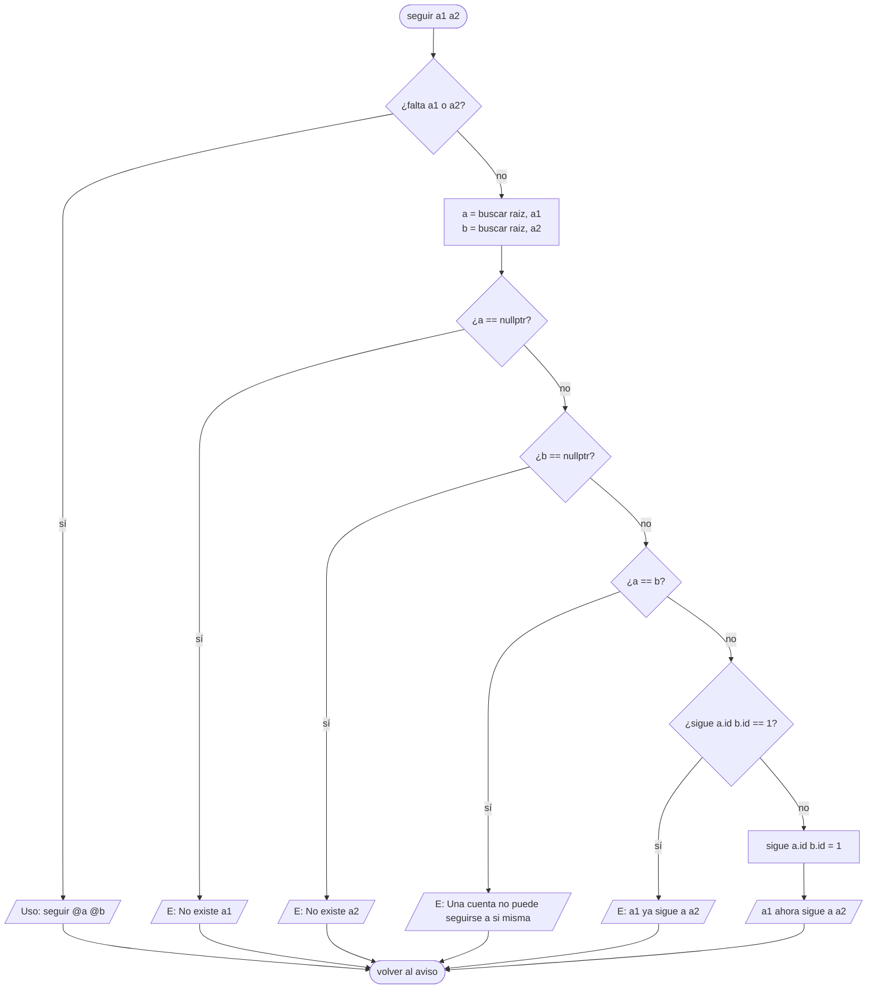
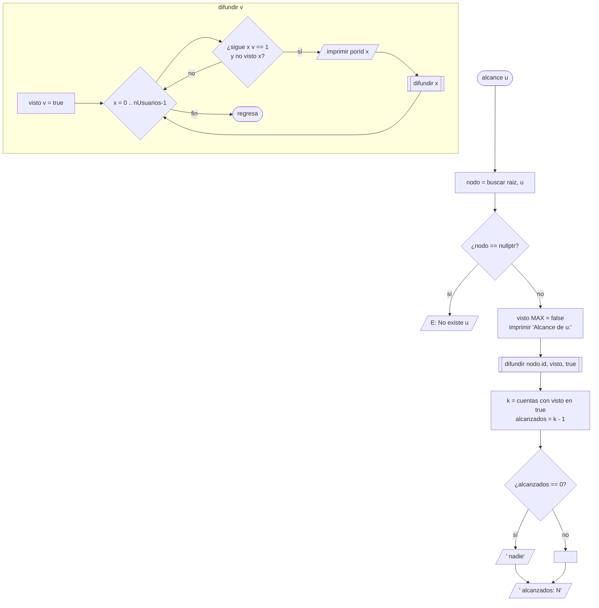

# Nido · Informe técnico — Sección 2.5 y Capítulos 3 y 4 (borrador E3 · v1.0)

**Grupo B · comunidad `nido-colibri` · NRC 42964**

> Borrador para pasar a la plantilla. Lo marcado con **[COMPLETAR]** depende de R5, R6 y R7 o de la ejecución final. Actualizado con el estado del repositorio al 22/11/2026, 22:00.

---

## 2.5 Diagramas de flujo

**seguir @a @b** (con todas sus validaciones, en el orden del Anexo R3b)



**alcance @u** (con el DFS recursivo `difundir`)



---

## Capítulo 3 · Desarrollo de la solución

### 3.1 Código fuente comentado

El programa completo va en el ZIP (`codigo/nido.cpp`). Aquí van los fragmentos clave de cada requisito y quién los escribió.

**R1 · Registro** — Fernandez Ramirez Patrick Michael · commit [`bb6f80f`](https://github.com/Basilercon/nido-42964-grupoB/commit/bb6f80f) · PR #11

```cpp
// r va por referencia (*&) para poder cambiar el puntero del padre (o la raiz).
bool insertar(NodoUsuario *&r, NodoUsuario *nuevo) {
    if (r == nullptr) { r = nuevo; return true; }          // caso base: hueco
    if (nuevo->usuario == r->usuario) return false;        // caso base: repetido
    if (nuevo->usuario < r->usuario) return insertar(r->izq, nuevo);
    return insertar(r->der, nuevo);
}
```

Sin el `*&`, el `r = nuevo` cambiaría solo una copia local del puntero y el nodo nunca quedaría colgado del padre.

**R2 · Directorio** — Fernandez Ramirez Patrick Michael · commit [`fee6d71`](https://github.com/Basilercon/nido-42964-grupoB/commit/fee6d71) · PR #11

```cpp
int altura(NodoUsuario *r) {
    if (r == nullptr) return 0;          // caso base: arbol vacio
    int a = altura(r->izq);
    int b = altura(r->der);
    if (a > b) return 1 + a;
    return 1 + b;
}
```

**R3 · Seguir** — Ticona Pacco Alex Royer · commit [`08c500e`](https://github.com/Basilercon/nido-42964-grupoB/commit/08c500e) · PR #12

```cpp
// seguidores = columna de id: x sigue a id si sigue[x][id] == 1
int contarSeguidores(int id) {
    int k = 0;
    for (int x = 0; x < nUsuarios; x++) if (sigue[x][id] == 1) k++;
    return k;
}
```

Validaciones de la orden `seguir` (corregidas en el PR #13 por Flores Castillo Basiler Emanuel), en el orden del Anexo:

```cpp
else if (a == b) cout << "E: Una cuenta no puede seguirse a si misma" << endl;
else if (sigue[a->id][b->id] == 1) cout << "E: " << a1 << " ya sigue a " << a2 << endl;
else {
    sigue[a->id][b->id] = 1;
    cout << a1 << " ahora sigue a " << a2 << endl;
}
```

**R4 · Comunidad** — Ticona Pacco Alex Royer · commit [`08c500e`](https://github.com/Basilercon/nido-42964-grupoB/commit/08c500e) · PR #12

```cpp
// mutuos: u sigue a x Y x sigue a u (fila y columna de u)
for (int x = 0; x < nUsuarios; x++)
    if (sigue[u->id][x] == 1 && sigue[x][u->id] == 1) marca[x] = true;
```

En `popular` se compara con `>` y no con `>=`: así, en un empate se queda la cuenta de menor id (regla 7).

**R5 · Alcance** — Machaca Apaza Edson Javier · **[COMPLETAR: commit y fragmento de `difundir`]**

**R6 · Persistencia** — Machaca Apaza Edson Javier · **[COMPLETAR: commit y fragmento de `guardarPreorden` y `cargar`]**

**R7 · Cierre** — Juan Diego Quispe Mollenido · **[COMPLETAR: commit y fragmento de `liberar`]**

### 3.2 Las funciones recursivas

| Función | Caso base | Caso recursivo | Qué devuelve o qué hace |
|---|---|---|---|
| `buscar` | `r == nullptr` o `r->usuario == u` | Baja a `r->izq` si `u` es menor; si no, a `r->der` | El nodo de la cuenta o `nullptr` |
| `insertar` | `r == nullptr` (cuelga el nodo) o usuario repetido | Baja a `r->izq` o `r->der` comparando | `true` si insertó, `false` si ya existía |
| `enorden` | `r == nullptr` | Izquierda, imprime el nodo, derecha | Cuentas en orden alfabético |
| `preorden` | `r == nullptr` | Imprime el nodo, izquierda, derecha | Orden de inserción que reconstruye el árbol |
| `contar` | `r == nullptr` → 0 | `1 + contar(izq) + contar(der)` | Número de nodos |
| `altura` | `r == nullptr` → 0 | `1 + max(altura(izq), altura(der))` | Altura en niveles |
| `hojas` | `r == nullptr` → 0; nodo sin hijos → 1 | `hojas(izq) + hojas(der)` | Número de hojas |
| `difundir` | Ningún seguidor de `v` sin visitar (el `for` termina sin llamadas) | Por cada `x` con `sigue[x][v] == 1` y `!visto[x]`: `difundir(x)` | Marca en `visto` (e imprime) las cuentas alcanzadas |
| `guardarPreorden` | `r == nullptr` | Escribe la línea `U`, luego izquierda y derecha | Las cuentas en `nido.txt`, en preorden |
| `liberar` | `r == nullptr` → 0 | `liberar(izq) + liberar(der)`, luego `delete r` (postorden) | Cantidad de nodos liberados |

### 3.3 Costo de las operaciones

| Operación | Pasos en el peor caso | Explicación breve |
|---|---|---|
| buscar en el ABB | altura del árbol (4 con nuestra ficha) | Cada comparación baja un nivel; nunca se revisan los dos subárboles |
| altura del árbol | n (10 nodos) | Visita cada nodo una vez |
| seguidores de una cuenta | n (`nUsuarios`) | Recorre una sola columna de la matriz |
| alcance (DFS) | n × n | Cada cuenta se visita una vez y por cada una se recorre su columna completa |
| cargar | n × altura + (seguimientos × altura) | Cada línea `U` inserta bajando por el árbol; cada línea `S` hace dos búsquedas |

**¿Y si las 10 cuentas se hubieran registrado en orden alfabético?** (`@byte, @cactus, @cometa, @cuy, @delta, @faro, @iglu, @mango, @orbita, @sushi`). Cada cuenta nueva sería mayor que todas las anteriores y quedaría como hijo derecho de la última: el árbol sería una lista de **altura 10**. Buscar la última cuenta (`@sushi`) costaría **10 comparaciones**, contra 3 en nuestro árbol (`@faro → @orbita → @sushi`). Por eso `guardar` escribe en preorden y no en enorden.

### 3.4 Capturas de validación y pruebas

- Salida completa de la secuencia oficial: [`pruebas/salida.txt`](../pruebas/salida.txt) **[COMPLETAR cuando estén R5 a R7: `nido.exe < pruebas\secuencia.txt > pruebas\salida.txt`]**
- Archivo generado con `guardar`: [`pruebas/nido.txt`](../pruebas/nido.txt) **[COMPLETAR]**
- Tabla de pruebas con esperado y obtenido: [`PRUEBAS.md`](../PRUEBAS.md) (P01 a P12 al 22/11).

**Comparación con la traza a mano (capítulo 2.4)** — estado al 22/11, 22:00:

| # | Orden | Traza a mano | Programa | ¿Coincide? |
|---|---|---|---|---|
| 1 | `arbol` | Preorden `@faro @cometa @cactus @byte @delta @cuy @orbita @mango @iglu @sushi`, altura 4, hojas 4 | Igual | Sí |
| 2 | `usuarios` | `@byte … @sushi` en orden alfabético | Igual | Sí |
| 3 | `perfil @delta` | `id 4 \| seguidores 2 \| siguiendo 2` | Igual | Sí |
| 4 | `seguidores @delta` | `@faro @cometa` | Igual | Sí |
| 5 | `siguiendo @delta` | `@cometa @byte` | Igual | Sí |
| 6 | `mutuos @delta` | `Mutuos de @delta (1): @cometa` | Igual | Sí |
| 7 | `popular` | `Popular: @cometa \| seguidores: 5` | Igual (desde el PR #13) | Sí |
| 8 | `alcance @sushi` | `@cometa @faro @cactus @byte @delta @cuy @mango \| alcanzados: 7` | **[COMPLETAR: R5]** | |
| 9 | `llega @sushi @byte` | `si` | **[COMPLETAR: R5]** | |
| 10 | `llega @delta @iglu` | `no` | **[COMPLETAR: R5]** | |

Diferencias encontradas en la revisión del 22/11 (código unido en el PR #12 sin revisión): `seguir` no rechazaba un seguimiento repetido ni imprimía `ahora sigue a`; `dejar` no validaba que existiera el seguimiento ni que las cuentas fueran distintas; `seguir` y `dejar` sin dos cuentas no mostraban `Uso:`; `popular` no usaba el formato del Anexo. Se corrigieron en el PR #13 (rama `fix-r3-r4`, 22/11). Después de la corrección, las órdenes 14, 15, 16, 17 y 20 de la secuencia oficial coinciden con la traza.

**[COMPLETAR]** Captura de `guardar → salir → abrir → cargar → arbol` con el mismo preorden y la misma altura.

### 3.5 Manual de usuario

**Compilar y ejecutar**

1. Abrir `nido.cpp` en Dev-C++. Si aparece un aviso de C++11: *Herramientas → Opciones del compilador*, marcar *Añadir estos comandos* y escribir `-std=c++11`.
2. Compilar y ejecutar con **F11**. Aparece el aviso `nido@nido-colibri:~$`.
3. Para ejecutar una secuencia guardada y guardar la salida, desde la carpeta del programa:
   ```
   nido.exe < pruebas\secuencia.txt > pruebas\salida.txt
   ```

**Órdenes** (cada una se puede escribir en español o en inglés)

| Orden | Ejemplo | Salida de ejemplo |
|---|---|---|
| `registrar @u` / `signup` | `registrar @lofi` | `Registrado: @lofi (id 10)` |
| `perfil @u` / `whois` | `perfil @delta` | `@delta \| id 4 \| seguidores 2 \| siguiendo 2` |
| `usuarios` / `users` | `usuarios` | `Usuarios (enorden): @byte @cactus …` |
| `arbol` / `tree` | `arbol` | `Preorden: …` y `Nodos: 10 \| altura: 4 \| hojas: 4` |
| `seguir @a @b` / `follow` | `seguir @lofi @orbita` | `@lofi ahora sigue a @orbita` |
| `dejar @a @b` / `unfollow` | `dejar @cometa @sushi` | `@cometa dejo de seguir a @sushi` |
| `seguidores @u` / `followers` | `seguidores @delta` | `Seguidores de @delta (2): @faro @cometa` |
| `siguiendo @u` / `following` | `siguiendo @delta` | `@delta sigue a (2): @cometa @byte` |
| `mutuos @u` / `mutuals` | `mutuos @delta` | `Mutuos de @delta (1): @cometa` |
| `popular` / `trending` | `popular` | `Popular: @cometa \| seguidores: 5` |
| `alcance @u` / `reach` | `alcance @sushi` | `Alcance de @sushi: @cometa … \| alcanzados: 7` |
| `llega @a @b` / `reaches` | `llega @sushi @byte` | `Un post de @sushi llega a @byte: si` |
| `guardar` / `save` | `guardar` | `Guardado: N cuentas y M seguimientos en nido.txt` |
| `cargar` / `load` | `cargar` | `Cargado: N cuentas y M seguimientos \| altura H` |
| `reporte` / `stats` | `reporte` | `Cuentas: N \| seguimientos: S \| pares mutuos: P` y `Arbol: altura H \| hojas K` |
| `ayuda` / `help` | `ayuda` | La tabla de órdenes |
| `salir` / `exit` | `salir` | `Nodos liberados: N. Hasta pronto.` |

**Mensajes de error** (ninguno cierra el programa)

| Mensaje | Cuándo aparece |
|---|---|
| `Uso: registrar @usuario` · `Uso: seguir @a @b` | Falta un argumento |
| `E: No se pudo registrar <u>` | Cuenta sin `@`, con mayúsculas o tildes, de más de 15 caracteres, repetida, o la comunidad ya tiene 12 cuentas |
| `E: No existe <u>` | La cuenta no está registrada |
| `E: Una cuenta no puede seguirse a si misma` | `seguir @a @a` |
| `E: <a> ya sigue a <b>` · `E: <a> no sigue a <b>` | Seguimiento repetido o inexistente |
| `E: No existe nido.txt` | `cargar` sin haber guardado antes |
| `<orden>: orden no encontrada (escribe ayuda)` | Orden que no existe |

**Guardar y cargar.** `guardar` escribe `nido.txt` en la carpeta del programa: una línea `U @usuario id` por cuenta en preorden y una línea `S @a @b` por seguimiento. `cargar` borra la comunidad actual y la reconstruye desde ese archivo con los mismos ids, así que después de cargar `arbol` y `reporte` dan lo mismo que antes de guardar.

---

## Capítulo 4 · Evidencias del trabajo en equipo

### 4.1 Repositorio y tablero

- Repositorio (privado): https://github.com/Basilercon/nido-42964-grupoB
- Tablero (GitHub Projects): https://github.com/users/Basilercon/projects/1
- Etiquetas: `v0.1` (19/11), `v0.5` (20/11), `v1.0` **[COMPLETAR: fecha]**

**[COMPLETAR]** Captura del tablero al final de cada etapa (E1, E2 y E3).

| Issue | Requisito | Estado al 22/11, 22:00 |
|---|---|---|
| #1 | R1 · Registro | Cerrado por el PR #11 |
| #2 | R2 · Directorio | Cerrado por el PR #11 |
| #3 | R3 · Seguir | Cerrado (PR #12) |
| #4 | R4 · Comunidad | Cerrado (PR #12) |
| #5 | R5 · Alcance | Abierto |
| #6 | R6 · Persistencia | Abierto |
| #7 | R7 · Cierre | Abierto |
| #8 | Informe | Abierto |
| #9 | Presentación | Abierto |

### 4.2 Commits, ramas y fusiones

**[COMPLETAR]** Captura de *Insights → Contributors* y de la lista de pull requests.

Datos tomados del historial de `main` al 22/11, 22:00 (sin contar los commits de merge):

| Integrante | Commits | Pull requests abiertos | Revisiones hechas | Espacios TODO que escribió |
|---|---|---|---|---|
| Flores Castillo Basiler Emanuel (Basilercon) | 8 | #10, #13 | #11 (aprobado) | Corrección de R3b, R3c y R4b (PR #13); líder: informe, actas, merges, etiquetas |
| Fernandez Ramirez Patrick Michael (72672623-cmyk) | 4 | #11 | — | R1a, R1b, R1c, R1d, R2a, R2b, R2c, R2d, R2e |
| Ticona Pacco Alex Royer (Royer20061) | 5 | #12 | — | R3a, R3b, R3c, R3d, R4a, R4b |
| Machaca Apaza Edson Javier (Edson-JMA) | 0 | — | — | **[COMPLETAR: R5a, R5b, R5c, R6a, R6b, R6c]** |
| Juan Diego Quispe Mollenido (61161913-jpg) | 0 | — | — | **[COMPLETAR: R7a, R7b]** |

| PR | Rama | Autor | Revisó | Unido por | Fecha de unión |
|---|---|---|---|---|---|
| #10 | `informe-cap1-2` | Basilercon | — | Basilercon | 20/11, 23:23 |
| #11 | `r1-registro` | 72672623-cmyk | Basilercon (aprobado) | Basilercon | 22/11, 01:15 |
| #12 | `r3-r4-grafo` | Royer20061 | — (sin revisión) | Royer20061 | 22/11, 20:55 |
| #13 | `fix-r3-r4` | Basilercon | — | Basilercon | 22/11, 22:24 |

### 4.3 Plan de trabajo, roles y cronograma

| Tarea | Responsable | Fecha planificada | Fecha real | Estado |
|---|---|---|---|---|
| Repositorio con el kit, invitaciones, tablero, v0.1 | Flores | 19/11 23:59 | 19/11 23:10 | Hecho |
| Árbol y matriz dibujados a mano | Todos | 20/11 18:00 | 20/11 (árbol en draw.io) | Parcial: falta la foto de la matriz |
| Capítulos 1 y 2 del informe con la traza | Quispe, Machaca → Flores | 20/11 22:00 | 20/11 22:51 | Hecho (reasignado al líder) |
| Etiqueta v0.5 | Flores | 20/11 23:59 | 20/11 23:23 | Hecho (sin R1 a R3) |
| R1 y R2 | Fernandez | 20/11 22:00 → 21/11 12:00 (acta 2) | 21/11 23:40 (PR #11) | Hecho |
| R3 y R4 | Ticona | 20/11 22:00 → 21/11 12:00 (acta 2) | 22/11 20:52 (PR #12) | Hecho; corregido por Flores en el PR #13 (22/11 22:24) |
| R5 y R6 | Machaca | **[COMPLETAR]** | | |
| R7 y pruebas finales | Quispe | **[COMPLETAR]** | | |
| Capítulo 3 y presentación | Flores | 22/11 | | En curso |
| Capítulo 4, acta 3, v1.0 y ZIP | Flores | 23/11 07:00 | | |

### 4.4 Actas de reuniones

Las actas completas están en [`ACUERDOS.md`](../ACUERDOS.md).

- **Acta 1 (19/11, virtual, los cinco integrantes).** Se eligieron los roles y se repartieron R1 a R7. El líder creó el repositorio, el tablero y la v0.1; se acordó entregar R1 a R3 y los capítulos 1 y 2 el 20/11 a las 22:00.
- **Acta 2 (20/11, registro del líder).** Al cierre de la E2 no había ramas con R1 a R3. El líder redactó los capítulos 1 y 2 y entregó la v0.5 con lo que había en `main`. Se movió el plazo de R1 a R3 al 21/11 y se acordó avisar al docente del estado de la E2.
- **Acta 3 (**[COMPLETAR]**).**

**Acuerdos que cambiaron:** el plazo de R1 a R3 pasó del 20/11 22:00 al 21/11 12:00 porque nadie subió código antes del cierre de la E2. Los capítulos 1 y 2, asignados a Quispe y Machaca, los redactó el líder para no dejar la v0.5 sin informe.

### 4.5 Reflexión del equipo

**[COMPLETAR con el equipo.]** Puntos para discutir:

- **Qué funcionó:** el flujo de una rama por requisito y un PR por integrante (#11 y #12); el CI detectó desde la v0.1 que faltaba el código.
- **Qué conflicto tuvimos:** los plazos de la Etapa 2 no se cumplieron y el trabajo se concentró en pocos integrantes. Un PR se unió sin revisión y llevó errores a `main` que el CI no detectó, porque `esperado.txt` solo tenía la línea del punto de control.
- **Qué haríamos distinto:** llenar `esperado.txt` con toda la traza a mano desde el principio, para que el CI detecte cualquier diferencia; no unir un PR sin la revisión acordada en `ACUERDOS.md`; confirmar el primer día que todos aceptaron la invitación al repositorio.
- **¿Qué cambió respecto de Tux Store?** **[COMPLETAR]**
